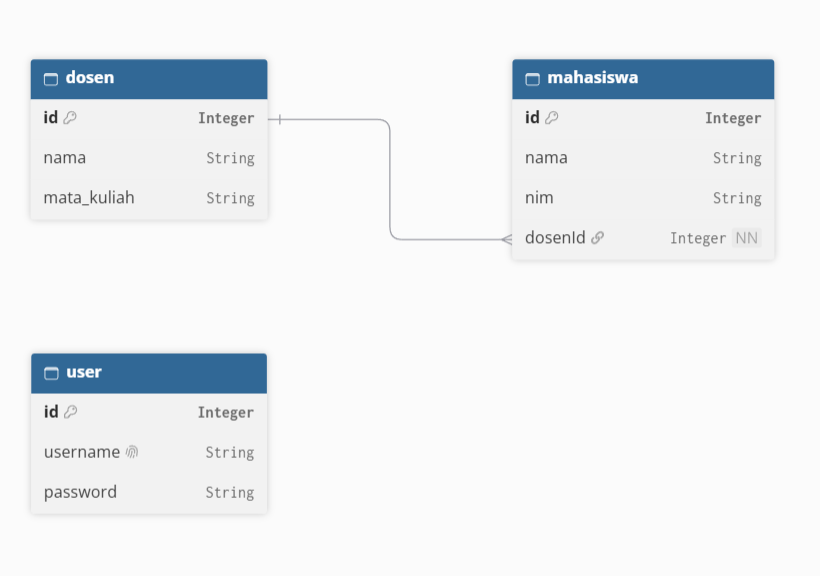
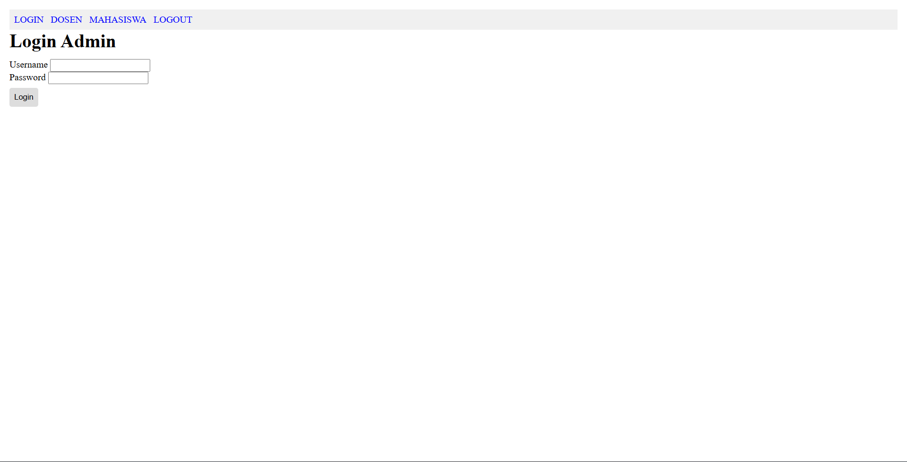
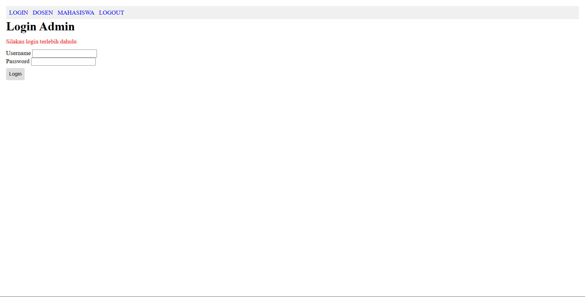
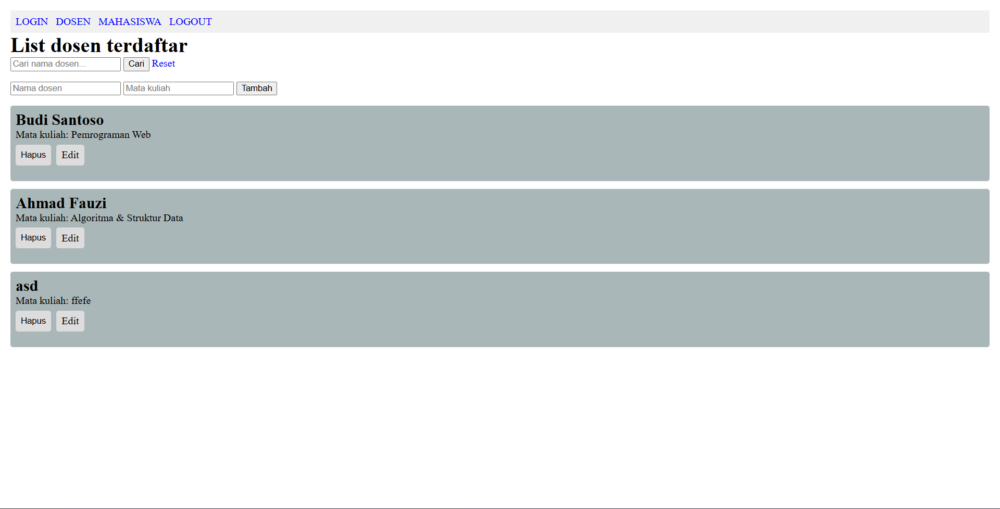
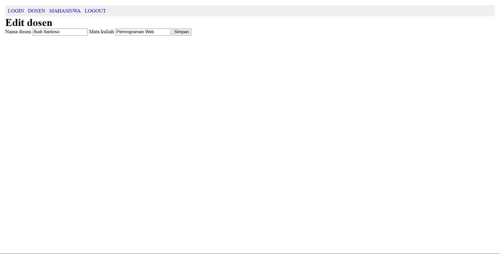
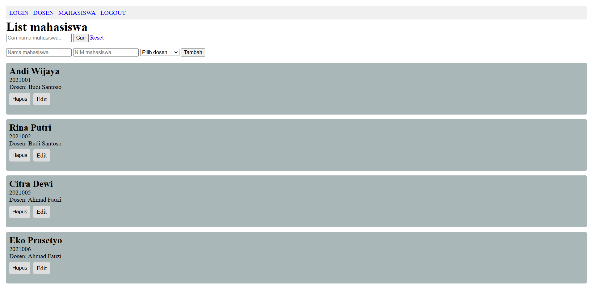
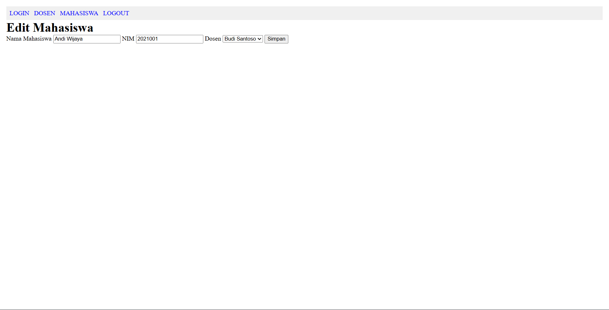

# Admin Panel Dosen dan Mahasiswa

Admin panel berbasis NestJS untuk mengelola data **Dosen** dan **Mahasiswa**.

## Fitur

- Login admin berbasis session
- CRUD data Dosen
- CRUD data Mahasiswa
- Relasi Dosen dan Mahasiswa
- Pencarian data Dosen dan Mahasiswa
- Validasi input
- Server-side rendering menggunakan Handlebars
- Database SQLite menggunakan Prisma ORM

## Dependency

- Node.js 20+
- Bun
- TypeScript
- NestJS
- Prisma
- SQLite
- Handlebars
- Express Session
- class-validator
- class-transformer
- bcrypt

Install dependency:

```bash
bun install
```

## Menjalankan Project

### 1. Clone repository

```bash
git clone https://github.com/rsstst/tt-dot.git
cd tt-dot
```

### 2. Buat file environment

Buat file `.env` di root project:

```env
DATABASE_URL="file:./dev.db"
```

### 3. Siapkan Prisma dan database

```bash
bunx prisma generate
bunx prisma migrate deploy
bunx prisma db seed
```

Akun demo:

```text
Username: admin
Password: admin123
```

### 4. Jalankan aplikasi

```bash
bun run start:dev
```

Buka aplikasi di:

```text
http://localhost:3000
```


## Desain Database



## Endpoint

| Method | Route | Keterangan |
|---|---|---|
| GET | `/` | Redirect ke login |
| GET | `/login` | Halaman login |
| POST | `/login` | Proses login |
| GET | `/logout` | Logout |
| GET | `/dosen` | List dan pencarian Dosen |
| GET | `/dosen/:id/edit` | Form edit Dosen |
| POST | `/dosen` | Tambah Dosen |
| POST | `/dosen/:id` | Update Dosen |
| POST | `/dosen/:id/delete` | Hapus Dosen |
| GET | `/mahasiswa` | List dan pencarian Mahasiswa |
| GET | `/mahasiswa/:id/edit` | Form edit Mahasiswa |
| POST | `/mahasiswa` | Tambah Mahasiswa |
| POST | `/mahasiswa/:id` | Update Mahasiswa |
| POST | `/mahasiswa/:id/delete` | Hapus Mahasiswa |

## Screenshot

### Halaman Login



### Tampilan Saat Gagal Login


### Halaman Dosen



### Halaman Edit Dosen


### Halaman Mahasiswa



### Halaman Edit Mahasiswa


## Demo dan Penjelasan Singkat

```text
https://youtu.be/mkbZ6COoXjg
```

## Catatan untuk Developer Selanjutnya

- Tambahkan test untuk setiap fitur.
- Session key masih hardcoded, bisa menggunakan .env
- Seeder saat ini hanya untuk database lokal.
- Error handling masih belum standar, banyak yang berbeda - beda. Bisa disamakan.